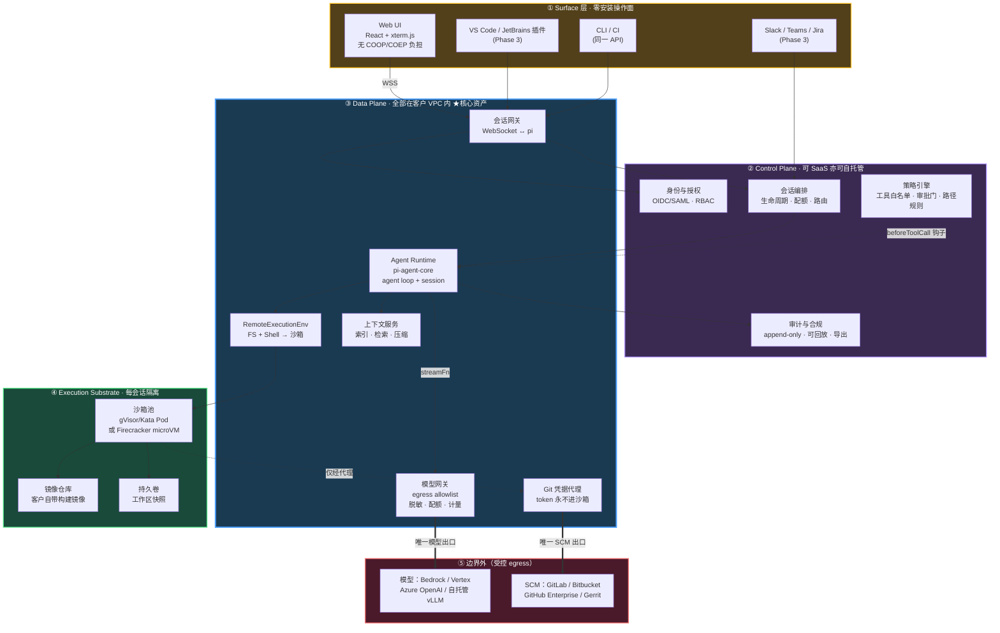
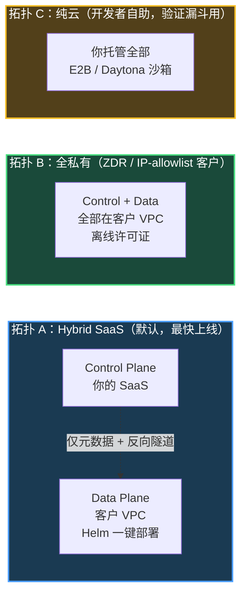
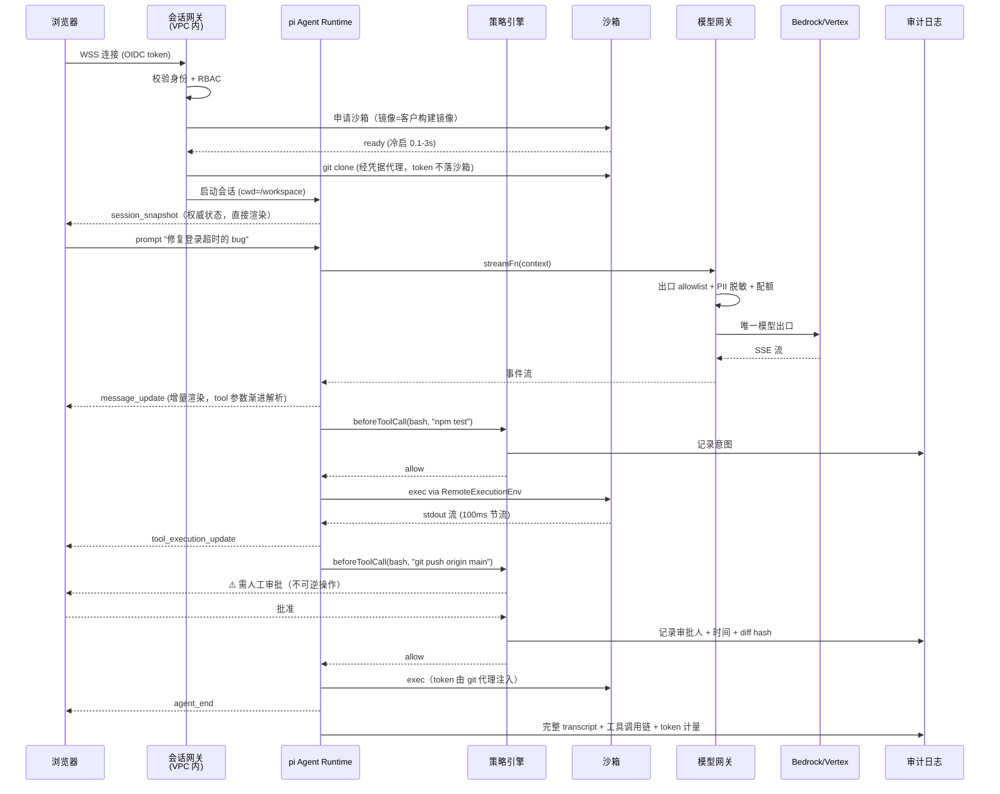
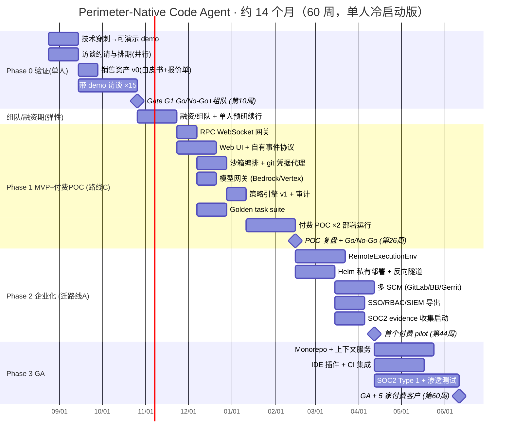

# 浏览器 Code Agent：第一性原理判断、架构设计与落地 Roadmap

> 版本 v1.2 · 2026-08-18（可执行性修订：按**「单人冷启动、未融资、未组队」**的真实资源重新校准全部节奏与门槛 —— demo 先行、访谈窗口放宽、付费信号分层、新增组队/资金 gate、免费 POC 改付费 POC、新增 golden task suite 与销售资产工作项、SOC2 evidence 前移。事实与证据部分未改动，仍以 v1.1 的核查为准。修订清单见附录 D）
> 版本 v1.1 · 2026-08-17（v1.0 经独立事实核查后修订：修正 10 处事实错误、弱化 8 处证据强度、修复 12 处逻辑问题，详见附录 C）
> 基于三路实地调研：pi 源码实测（clone + 跑通 CI 浏览器冒烟测试 + 手写 ExecutionEnv 验证）、市场竞品一手来源核查、浏览器/云沙箱执行环境技术验证。
> 决策前提（已与你确认）：**浏览器 UI + 云沙箱执行** · 目标用户为**企业内网/受管设备 + 已有仓库的日常开发维护** · 本次交付为战略文档。
> **执行前提（v1.2 新增）**：当前为**单人冷启动**。整个计划按「先验证 → 再组队/融资 → 再建设」排布；**Phase 1 及以后不以单人执行**，启动前置条件是资金到位（≥12 个月 runway）或 2–3 人全职到位。Phase 0 的产出同时就是融资/组队的证据包。

---

## 0. 结论摘要（先看这一页）

**"浏览器"不能作为这个产品的定价锚点和定位核心。但你选的这条路成立 —— 只是它的名字不该叫"浏览器 code agent"。**

一句话定位：

> **一个可完全私有部署的 code agent 运行时，代码与凭据永不出客户网络边界，浏览器只是零安装的操作面。**

三个核心判断：

| 判断 | 内容 | 证据强度 |
|---|---|---|
| **反面** | 浏览器不是价值锚，也不能独立定价。稀缺的是「能跑你真实代码的环境 + 凭据 + 权限」，浏览器一个都不提供。头部厂商自己的产品设计已经承认这点：Claude Code 是 `--cloud`/`--teleport` 双向搬移，Cursor Remote Control 甚至把 tool call 放回用户自己的机器 | 强 |
| **正面** | 存在一个头部**尚未做透**的市场：开启 ZDR 的组织用不了 Claude Code 云会话；开启 IP allowlist 的组织托管会话全部认证失败（**有官方豁免流程，也可走 self-hosted 绕过**）；GitLab/Bitbucket 只能 bundle 上传且除非另配 GitHub 认证否则不能推回 | **中**（官方文档明文，但头部已在自建 self-hosted 方案 —— 这是**成熟度窗口**，不是结构性空白） |
| **可行性** | pi（MIT）的架构恰好把这件事的成本压到极低：`ExecutionEnv` 是一个干净的可替换执行后端接口，40 个 LLM provider 覆盖 Bedrock/Vertex/Azure（企业唯一能过审的模型通道），RPC mode 有 35 个命令的成熟远程接口。**我实测跑通了 CI 里的浏览器打包 + 四个真实 tool 跑在自写的内存 ExecutionEnv 上** | 强（源码 + 实跑） |

**技术路线（分两步走，不要一步到位）：**

- **Phase 1（第 11–26 周，前置条件：资金或 2–3 人到位）**：`pi --mode rpc` + 一个 WebSocket 网关 → 立刻拿到 35 个命令 + 完整事件流 + 扩展 UI 协议。这是**最快拿到可 demo 产品**的路径，风险最低。
- **Phase 2（第 27–44 周）**：迁到 `pi-agent-core` 的 `AgentHarness` 路径，自己实现 `ExecutionEnv` 把 FS/Shell 打到沙箱，拿回对权限、审计、多沙箱后端的完全控制权。

**必须先杀掉的假设（Phase 0，第 1–10 周，单人可完成）**：先用 3 周把技术穿刺做成**可演示的 demo**（这也是你唯一的访谈武器），再带着 demo 做 15 场访谈，拿到**分层的可验证付费信号**：**≥2 个硬信号（签署 LOI / 付费 POC 书面承诺）+ ≥3 个中信号（指名预算行 + 审批路径 + 同意进入付费 POC 评估）**。口头"愿意付钱"不算任何一层。**这一条不成立，后面全部不做；成立，则 Phase 0 的证据包直接用于融资/组队 —— Phase 1 不以单人启动。**

（v1.2 校准说明：v1.1 要求"4 周内 15 场访谈 + 5 个 LOI 级信号"，这是按 2–3 人全职校准的。单人 + 无 demo + 企业访谈 1–3 周的约请 lead time，4 周物理上不可达 —— 硬门槛定在不可能的时间上，等于把一个可能成立的论点在执行层面误杀。信号总量要求未降低（2 硬 + 3 中 ≥ 5），只是分层并放宽到 10 周。）

---

## 1. 第一性原理：拆到不能再拆

### 1.1 一个分析框架（不是论证，只是分类工具）

把一个 code agent 能交付的价值拆成四个**供给来源不同**的约束项：

```
价值 ≈ f(模型能力, 环境保真度, 上下文可达性, 授权与信任)
```

四项都是**必要不充分**：任何一项塌陷，整体不可用。逐项看谁供给、谁稀缺：

| 约束项 | 含义 | 供给方 | 2026 年是否稀缺 |
|---|---|---|---|
| **模型能力** | 能不能写对代码 | Anthropic / OpenAI / Google，几家寡头 | **不稀缺**（你买不到差异化，也做不出差异化） |
| **环境保真度** | 能不能跑真实构建、真实测试、真实依赖 | 执行基座（容器 / microVM / WASM） | **稀缺**（WebContainer 连 pip 都没有；云 agent 到手是 blank canvas） |
| **上下文可达性** | 能不能读到私有仓库、内网 API、内部文档、CI 日志 | 网络位置 + 凭据 | **极稀缺**（这是纯云 agent 的死穴） |
| **授权与信任** | 允许它改什么、推什么、部署什么；能否审计、回滚、解释 | 组织的信任决策 + 产品设计 | **极稀缺**（Stack Overflow 2025：只有 3.1% 开发者高度信任 AI 代码，45.7% 主动不信任） |

> ⚠️ **这个框架不能用来"证明"任何品类不成立。** 按同样的分解，**任何 UI 与分发形态都不在这四项里** —— 它同样可以"证明" VS Code 不成立、iPhone 不成立。分发不进约束项，只说明它不是能力瓶颈，不说明它不能构成品类。真正承重的论证在 1.2 的检验 ③。

**浏览器在这个框架里提供了什么？** 严格地说：**零安装的操作面**。它降低的是"开始使用"的摩擦，属于分发问题。

**浏览器不能提供什么？** 执行环境（COOP/COEP + 无 pip + 无原生模块 + 4GB wasm 上限）、凭据（key 在客户端必然可被 XSS 窃取）、权限（浏览器没有组织授权概念）、持久性（**关掉页面任务必死，这是平台级限制，无工程解法**）。

> ⚠️ 这条推论很硬：**如果"关闭浏览器后任务继续跑"是产品需求，纯浏览器方案在架构上直接出局。** Dedicated Worker 随页面销毁；`SharedWorker` 的 `extendedLifetime` 官方定位是"写状态、发 analytics"，不是跑长任务；Service Worker 会被浏览器主动杀死。这应该是选型的第一道筛子 —— 你选"浏览器 UI + 云沙箱"是对的。

### 1.2 三个"不可替代"检验

一个形态要成为品类，浏览器必须是**必要条件**而不是便利条件。用三个问题检验：

| 检验 | 通过？ | 说明 |
|---|---|---|
| **① 装不了 CLI 的场景存在吗？** | ✅ 通过 | 受管设备（MDM 禁装）、VDI、外包/驻场人员、审计要求"所有操作可录制回放"的环境。这些场景里浏览器是唯一入口 |
| **② 浏览器能提供 CLI 提供不了的东西吗？** | ✅ 有条件通过 | 可观测性（每一次 diff 审批、每一次工具调用都天然在服务端留痕）、多人协同看同一个 session、无状态设备切换。CLI 要做到这些必须额外建后端 |
| **③ 这个优势能撑起独立定价吗？** | ⚠️ **不通过** | 个人档对比：Copilot Pro $10/月含云 agent，Cursor Pro $20/月含云 agent，Claude Code **云 VM 不额外计费**。"浏览器可用"这件事已经是免费赠品，你无法为它定价 |

**③ 不通过是决定性的，它也是本节唯一承重的论证。** ①② 都通过，说明浏览器形态**有真实场景**；③ 不通过，说明它**不能作为收费理由**。两者结合的结论不是"品类不成立"，而是：

> 浏览器是交付形式，不是定价锚点。要卖的必须是别的东西。

所以修正定位：不卖"浏览器"，卖"**边界内**"。买方为"代码不出网"付钱，浏览器是顺带的交付形式。

（注意：③ 用的是个人档价格论证"浏览器不能定价"；而 8.2 用团队档价格（Copilot Business $19、Cursor Teams $40）论证"$40–80/席位的溢价合理"。两处档位不同是刻意的 —— 前者比的是"云 agent 可用性"这个免费赠品，后者比的是"团队级采购"的价格带。引用时请勿混用。）

### 1.3 品类命名的修正

```
❌ 错误命名：Browser-based Code Agent
   → 与 bolt.new / Lovable / v0 撞进同一格，那一格已被 Lovable（$500M ARR @2026/06，
     $13.3B 估值）打完，且 churn 是结构性的（Bolt CEO 自述：
     "The churn rate for everyone is really high"，并因此主动放弃 consumer 转 B2B）

✅ 正确命名：Perimeter-Native Code Agent Runtime（边界原生 agent 运行时）
   → 卖的是：agent 在你的 VPC 里跑、你的模型通道、你的审计日志、你的权限模型
   → 浏览器是：零安装的操作面（顺带解决受管设备问题）
   → 竞争对手不是 bolt.new，是「自建一套」这个选项
```

这一步改名不是文字游戏，它决定了：定价（按席位/按节点，而非按 token）、买方（平台工程/安全，而非个人开发者）、护城河（部署与合规的深度，而非模型能力）、以及最重要的 —— **避开了个人开发者账户毛利为负的陷阱**（Cursor 至今在个人账户上亏钱）。

---

## 2. 市场：证据、缺口与反方

### 2.1 大盘与头部曲线

| 指标 | 数字 | 来源口径 |
|---|---|---|
| AI code tools 市场 | 2026 = **$9.35B** → 2031 = **$29.96B**，CAGR **26.23%** | Mordor Intelligence |
| 同上（另一口径） | 2026E = **$9.8B** → 2030 = **$26.0B**，CAGR 27.1% | Grand View Research |
| **云 vs on-prem** | 云 2025 占 **72.47%** 收入（存量份额）；**on-prem 的 CAGR 为 26.55%，高于大盘整体的 26.23%**，Mordor 明确归因于受监管行业（银行/医疗/国防）与 EU AI Act | Mordor |
| Cursor | $2B ARR run-rate（2026/02），预测年底 $6B；估值洽谈 $50B pre | TechCrunch / CNBC |
| Lovable | **$500M ARR（2026/06，TechCrunch 确认）**；$13.3B 估值、$400M Series C（2026/08/12）。另有二手报道称"接近 $600M" —— 属**目标/趋近**，不是已实现，勿引用 | TechCrunch / Bloomberg |
| GitHub Copilot | **50M 用户**；**GitHub 上 1/3 的 PR 涉及 agent** | Microsoft **FY26 Q4 财报电话会**（Nadella 口述；注意 press release 本身未提及此数） |
| Bolt.new | $40M ARR（约 2025/03）✓、估值约 $700M ✓；**"已盈利、毛利 70%+"出自创始人访谈自述，非审计数据**，证据等级低于本表其他行 | Sacra 访谈 |

**需求侧现实检查（Stack Overflow Developer Survey 2025，49,000+ 人 / 177 国，结果 2025-12 发布）：**

- 84% 在用或计划用 AI 工具，但**只有 3.1% 高度信任** AI 生成的代码，**45.7% 主动不信任**
- **66%** 抱怨 "almost right, but not quite"；**45.2%** 说 debug AI 代码比自己写更久
- **agent 采用率仅 31.1%，37.9% 明确无采用计划** —— 但 agent 用户中 **69% 报告个人生产力提升**

> 📌 **常见误引，务必避开**：广泛流传的"PR 周转 9.6 天 → 2.4 天"**不是**这份调查的数据，而是 **Accenture 部署 GitHub Copilot 的单一企业案例**。单个大型系统集成商的内部结果，不能用来论证普遍性。

这组数字怎么读，我的判断是**克制的**：agent 在**已采用的少数人**（31%）身上有正反馈（69% 报告提效），但同一份调查里 66% 的 "almost right" 和 45% 的 "debug 更慢" 是**能力问题的直接证据，不是信任问题**。准确的说法是：

> **能力和信任同时构成瓶颈。** "边界内 + 全审计 + 权限门"能直接攻击信任那一半，对能力那一半无能为力 —— 这决定了 POC 阶段必须**限定任务类型**（见 R7），不能承诺"全自动开发"。

### 2.2 你锚定的两个缺口 —— 证据逐条列出

**缺口 A：合规闸门（证据强度：中，官方文档明文但均有官方绕道）**

| 证据 | 官方给出的绕道 | 出处 |
|---|---|---|
| 开启 **Zero Data Retention** 的组织不能使用 `/web-setup` 等 cloud session 功能 | 官方原句围绕 `/web-setup` 展开，**未明说 self-hosted environment 的会话是否也被禁 —— 这个边界值得单独确认，它直接决定缺口大小** | Anthropic 官方文档 |
| 开启 **IP allowlist** 的组织，**每一个** Anthropic 托管的 cloud session 都会认证失败 | ⚠️ 同一段紧接着写：可联系 Anthropic support 将其服务豁免出 allowlist；且 self-hosted environment 的会话从客户自己的网络发起，不受影响 | 同上 |
| 从 bundle 创建的会话**不能推回远端**（除非另行配置 GitHub 认证）；GitLab / Bitbucket 只能 local bundle 上传 | bundle > 100MB 时是**三级降级**（只打包当前分支 → 工作树 squash 快照 → 仍过大才失败），不是一刀切 | 同上 |
| Claude Code web 会**强制覆盖**用户的 auto-compact 设定（`CLAUDE_AUTOCOMPACT_PCT_OVERRIDE` 由平台设定，用户改同名环境变量无效） | 无 | 同上 |
| Prompt injection 被 OWASP **映射到 Agentic Applications Top 10 的 10 类中的 6 类** | — | Help Net Security 2026/06 |
| **Anthropic 已做 self-hosted environments、Cursor 已做 Self-Hosted Pools + "My Machines" Remote Control** | — | 双方官方文档 |

**最后一条是全文最重要的一条，也是最该让你警惕的一条**：头部不是"结构性回避"这个市场，**它们已经在做了**。这意味着：

- 痛点是真的（大客户在要，否则他们不会建）
- 但你的机会窗口是**功能成熟度差**，不是**结构性空白** —— 性质完全不同
- 因此缺口 A 的证据强度应标 **中**，不是强。§0 摘要已按此口径修正

**缺口 B：已有大型仓库 + 非 JS 生态被系统性排除（证据强度：强）**

- WebContainer 只支持 Node/npm/WASM。**Python（无 pip）、Go、Rust、native binary、Docker、GPU 全部无解**
- Jules / Codex Cloud / Claude Code web 都是 GitHub 中心
- 含义：企业里的 monorepo、Java/.NET 后端、数据/ML 代码库**几乎全在射程外**

**缺口 C：成本不可预测（证据强度：强）**

- **Replit 的 effort-based pricing 事故（2025 年 6–7 月，不是 2026）**：公告 2025-06-18，复盘 2025-07-13。Replit 官方原话承认 `"the transition to the new pricing model did not meet our standards for how we like to roll out major changes"`，但**计价模型本身没改**。
  ⚠️ 广为流传的"失败也计费""为一个不存在的方法付 $1.15""账单从月 $180-200 跳到周约 $1,000"这些具体数字**来自用户论坛投诉，不在 Replit 官方复盘文里** —— 对外引用时必须标注为用户投诉，不能挂在官方链接下
- Lovable 的 credit 阶梯陡峭（Free 30 credits/月，Pro 从 $25/100 credits 起，高档位价格逐级放大）。**具体的高档位数字（$2,250 / $4,300）无法从公开定价页核实，已从本文删除** —— 定价页是客户端渲染，抓不到结构化数据
- 反向：Claude Code on the web 明确"cloud VM 不额外计费" —— **大厂用补贴把独立玩家的定价空间压到零**

→ 对你的启示：**按席位/按部署节点定价，不要按 token 或 effort 计价。** 企业买方要的是可预测的预算行，不是用量赌博。

### 2.3 反方论点（必须正面回答，不要绕开）

| 反方 | 力度 | 我的回应 |
|---|---|---|
| **这个形态在三年内被四家有钱有分发的公司分别放弃了一次**：Replit Teams for Education（2024/08 关停）、CodeSandbox CI 2026/04/15 + Repos 2026/07/15 关停 + Sandpack 停维护、GitHub Classroom（2026/08/28 全面下线，数据 09/04 删除）、Firebase Studio（2026/06 停新注册，**2027/03/22 完全下线**） | **很强** | 他们放弃的是 **消费级/教育级浏览器 IDE**，不是企业边界内运行时。但这条提醒：**别碰教育和消费级** |
| **头部的产品路径是"从云走回本地"**：Codex 从 cloud-web-first 转向 macOS/Windows 桌面 app + 本地沙箱 + git worktrees；Google 砍掉 Firebase Studio 和 Gemini CLI 免费档 | **强** | 印证 1.1 的结论：价值在环境保真度，不在浏览器。你的架构必须把**执行基座**当核心资产，浏览器只是壳 |
| **定价空间被平台捆死**：Copilot $10/月含云 agent，Claude Code 云 VM 免费 | **强** | 这就是为什么必须卖"边界内"而不是"云 agent"。买方是安全/平台预算，不是开发者工具预算 |
| **需求侧热度不高**：HN "Ask HN: Are cloud coding agents useful in real workflows yet?" 只有 **7 分、3 条评论**；而云沙箱执行类的 Show HN（Twill.ai）有 **77 分、95 评** | **弱**（原始对比数据修正后强度大幅下降） | 方向仍成立（开发者更关心执行环境），但注意 Twill.ai 那个帖子的评论区主流意见恰恰是**质疑这类产品没有差异化**（"Cursor / Claude Code / GitHub Agents 会吃掉你"）—— 对本文论点是反向证据，不是顺风 |
| **HN 对云 agent 编排创业的判断**："GitHub 已经 agent 中立了，我看不出这是个生意" / "Anthropic 和 Cursor 会吃掉你" | 强 | 对"通用多 agent 面板"完全成立。对"部署在客户 VPC 内"部分成立 —— 但**必须按 12–18 个月窗口规划，不要按十年生意规划** |
| **没找到一个"企业因为不能装 CLI 而采购浏览器 agent"的公开案例** | **强，且是最该担心的一条** | 企业的现实解法可能是"自托管 runner + 企业浏览器/VDI + 自建网关"，而不是买第三方产品。**这就是 Phase 0 必须验证的东西** |

### 2.4 判断与窗口期

**值得做，但要按有限窗口的生意来规划。**

```
乐观情形：企业采购周期 6-12 个月 + 头部的 self-hosted 方案做得半吊子
        → 你有 18-24 个月建立部署深度和多模型中立性的护城河
        → 退出路径：被 Anthropic / Cursor / GitLab / JFrog / HashiCorp 类买方收购

悲观情形：Anthropic 把 self-hosted environment 做成开箱即用，且云 compute 完全免费捆进订阅
        → 你的核心卖点在 12 个月内消失
        → 必须在此之前拿到：≥5 个付费企业客户 + 一个头部买不走的差异点
```

**两个领先指标，每季度盯：**

1. Stack Overflow 调查的 agent 采用率（**2025 = 31.1%**）。若 2026 或 2027 的调查跳到 60%+ → 窗口更长
2. on-prem 的 CAGR 是否持续高于大盘整体 CAGR（当前 **26.55% vs 26.23%**，量纲一致的比较）→ 高于则合规驱动仍在

**Kill criteria（写死，到点就砍）：**

- **Phase 0 结束（第 10 周，Gate G1）**：拿不到 **≥2 个硬信号（签署 LOI / 付费 POC 书面承诺）+ ≥3 个中信号（对方主动确认预算行 + 给出审批路径 + 同意进入付费 POC 评估）** → **停止**
  ⚠️ "访谈里说愿意付钱"是已知的弱信号，且访谈池由你自己筛选（金融/医疗/政务本就最可能说 yes），存在明显选择偏差。硬信号必须是**可验证的书面动作**。此外，比 LOI 更硬的信号是**付费 POC 承诺**（$10–25K / 6 周 / 限定任务类型）—— 访谈末端直接报价，愿意为 POC 掏钱的组织才是真客户
- **Gate G1 的第二出口（v1.2 新增）**：信号达标但 **6 个月内融不到钱也组不起 2–3 人团队** → 窗口判断失效，同样停止。备选路径（付费 POC 收入自举 + 兼职承包）只在已有 ≥2 个付费 POC 合同时可选
- **Phase 1 结束（第 26 周，与 POC 里程碑 m1 对齐）**：2 个付费 POC 里没有 **≥1 个**给出付费 pilot 续约意向（有金额、有时间表） → **停止**
- 任意时点：Anthropic/OpenAI 发布开箱即用的 self-hosted agent runtime 且免费捆绑 → **重新评估整个论点**

**窗口期矛盾必须直面（v1.2 新增）**：上文窗口期判断是 12–18 个月，而单人冷启动版计划全程约 60 周 —— 两者是冲突的。解法不是压缩工期（那只会做出交付不了的承诺），而是**把收入信号前移**：付费 POC 在第 26 周、付费 pilot 在第 44 周，用早期收入与部署深度占住窗口，而不是等 GA。如果第 26 周拿不到付费 POC 续约，就说明窗口对你已经关闭 —— kill criteria 会自动触发。

---

## 3. 为什么基于 pi（以及 pi 帮不了你什么）

### 3.1 pi 的事实（源码实测，非搜索摘要）

| 项 | 值 |
|---|---|
| 仓库 / 许可 | `badlogic/pi-mono`（= `earendil-works/pi`），**MIT**，作者 Mario Zechner |
| 版本 / 活跃度 | npm **0.84.2**；最近提交 **2026-08-17 当天** |
| 语言 / Node 要求 | TypeScript，`engines: node >= 22.19.0` |
| 核心包 | `pi-agent-core`（12,635 LOC，agent loop + harness + session）、`pi-ai`（**40 个 LLM provider + 1 个图像 provider**）、`pi-protocol`（CBOR）、`pi-client`、`pi-server`（experimental）、`pi-tui`、`pi-coding-agent`（CLI） |
| 默认工具 | **只有 4 个**：`read` / `bash` / `edit` / `write`（可选再加 `grep`/`find`/`ls`）|
| 系统提示词 | **2116 字符 ≈ 530 token**（本次调研实际渲染测得，非官方公布数字），且**每个 tool 的提示词片段由 tool 自己声明、按启用集合动态拼装** |
| 明确**不包含** | 内置 MCP、plan mode、子 agent、**权限弹窗**、todo、后台 bash、沙箱。官方原文：`It intentionally does not include built-in MCP, sub-agents, permission popups, plan mode, to-dos, or background bash.` |

**最关键的发现：pi 的浏览器/可移植性不是巧合，是有 CI 强制的设计目标。**

三条证据链：

1. `pi-agent-core` 的 12,635 行代码里，只有 **2 个文件**含 `node:` import：`harness/env/nodejs.ts`（唯一的 Node **运行时**实现，只从独立的 `./node` 入口导出）与 `harness/session/testing/conformance.ts`（一致性测试套件，只 import `node:assert/strict`，不进产物包）。`src/node.ts` 全文只有两行。
2. CI 有 `check:browser-smoke`，用 esbuild 以 `platform: "browser"` 打包 agent 主循环 + 会话存储 + 协议客户端。**本次调研实跑通过，exit 0，产出约 2.4MB bundle**，整个 bundle 里只有 1 处 `require("node:fs")` 且是被双重守卫的死代码。（自测结果，非官方数字）
3. 另有 tree-shaking 断言测试：只引 anthropic provider 时，bundle 里**只能有一个 SDK、一个 catalog**。

> ⚠️ **v1.2 叙事修正：浏览器可移植性本身在你的架构里不承重。** 在最终选定的架构（§4）里，pi 全部跑在服务端 Node 环境（客户 VPC 内），`RemoteExecutionEnv` 也是服务端代码 —— "pi 能打包进浏览器"这件事没有任何一条路径用到。这三条证据链真正证明的是 **pi 的抽象纪律**（接口干净、依赖边界由 CI 强制、`ExecutionEnv` 是真实可替换的抽象而非纸面设计），这才是选它的理由。不要在对外材料或内部叙事里把"浏览器可移植"当成技术卖点 —— 真正承重的是 3.2 的五个接缝。

### 3.2 五个接缝点（这是选 pi 的真正理由）

| 接缝 | 接口 | 你要拿它做什么 |
|---|---|---|
| **① 执行后端** | `ExecutionEnv extends FileSystem, Shell`（`packages/agent/src/harness/types.ts`） | **最重要**。把 FS + Shell 整体替换成"打到远端沙箱"。全部方法返回 `Result<T, E>` 而非 throw，错误码是后端无关枚举；连 `joinPath`/`canonicalPath` 都是接口方法，**所以连 `node:path` 都不用 shim** |
| **② 模型通道** | `ProviderRequestOptions.fetch?` 可注入 + `streamProxy`（纯 fetch/SSE，370 行，零 node 依赖） | 全部模型流量强制过你的网关，做 allowlist / 脱敏 / 配额 / 审计 |
| **③ 远程控制** | RPC mode（JSONL over stdio，**35 个命令 + 完整事件流 + 扩展 UI 协议**）或 `ByteTransport`（CBOR，`send(Uint8Array)` + 3 个回调） | 浏览器 UI 的接入点。RPC 成熟，CBOR 漂亮但 experimental |
| **④ 权限门** | `beforeToolCall` / `afterToolCall` 钩子（契约：**不许 throw**，返回安全 fallback），可 block 工具调用 | pi 没有权限系统 —— 这是你必须自建的部分，钩子是挂载点。参考 `examples/extensions/permission-gate.ts` |
| **⑤ 会话持久化** | `SessionStorage` 接口 + `JsonlSessionRepo` 只要求 **12 个 FS 方法** + `InMemorySessionRepo`；且官方提供 **conformance test suite** | 换成 Postgres/S3，用官方一致性测试验证实现合规 |

**我做的实证**：手写了一个纯浏览器风格的 `ExecutionEnv`（`Map<string, Uint8Array>` 当内存 FS，自实现路径归一化），然后把 pi 的**四个真实 tool 原封不动**跑在上面 —— write/read/edit/read/bash 全部通过，零改动、零 `node:fs`、零 `node:path`。

```
write: Successfully wrote 12 bytes to a.txt
read : hello\nworld\n
edit : Successfully replaced 1 block(s) in a.txt.
read2: hello\nbrowser\n
bash : [sim] echo from-shim
```

**`ExecutionEnv` 抽象是真的，不是纸面设计。** 这是整个技术方案的地基。（上述四工具跑通为本次调研自测；接口签名本身已逐字比对源码确认。）

### 3.3 两个必须知道的坑

**坑 1：仓库里有两套四工具实现。**

| | 位置 | 后端 | 可移植 |
|---|---|---|---|
| **A（新，用这个）** | `packages/agent/src/harness/tools/*.ts` | `ExecutionEnv` 注入 | ✅ 零 node import |
| **B（旧，别碰）** | `packages/coding-agent/src/core/tools/*.ts` | 默认直连 `node:fs` + `Buffer`，注入接口漏了 Node 类型 | ❌ |

**但当前 TUI / RPC mode / SDK 走的是 B。** 这意味着：Phase 1 走 RPC 网关会用到 B（没关系，它跑在你的服务端），Phase 2 迁移时必须切到 A。这个迁移是 Phase 2 的主要工作量。

**坑 2：扩展机制是 Node-only。** pi 用 `jiti` 在运行时加载 TS 扩展，`.pi/extensions/`、包分发（`npm:`/`git:`/`https:`）全部依赖 Node。这在你的架构里没问题（扩展跑在服务端），但意味着**不要幻想把扩展生态搬到浏览器**。

### 3.4 与替代方案对比

| 方案 | 上手成本 | 可控性 | 许可风险 | 判断 |
|---|---|---|---|---|
| **pi** | 低（4 tool + 干净接缝 + 530 token 提示词，全部可读完） | **高**（MIT，可 fork，接缝明确） | 无 | ✅ **选它** |
| Claude Agent SDK | 低 | 中（绑定 Anthropic，企业要 Bedrock/Vertex 时受限） | 商业条款 | 备选，但违背"多模型中立" |
| OpenCode 等开源 CLI | 中 | 中（体量大得多，抽象没 pi 干净） | 多为 MIT/Apache | 可参考，不作地基 |
| 完全自研 agent loop | 高（agent loop 的正确性细节比看起来多得多，见下） | 最高 | 无 | ❌ 浪费 3 个月 |

pi 的 agent loop 里有一批"自己写会踩三个月"的正确性细节，值得单独列出来说明为什么不自研：

- `stopReason === "length"` 时（输出被 token 上限截断），**全批 tool call 作废绝不执行** —— 因为参数可能不完整
- steering / follow-up 双队列：用户在 agent 思考时输入的消息如何注入，启动即检查
- prepare（串行校验 + 钩子）/ execute（并发）/ finalize（钩子）三阶段，tool 可自行强制串行
- 所有钩子契约是"不许 throw，返回安全 fallback"；`StreamFn` 的错误必须编码进流里的 `stopReason: "error"` 而不是 reject
- `convertToLlm` 强制显式投影：`AgentMessage` 是开放联合类型（可加自定义消息类型），UI-only 消息在投影时被过滤

---

## 4. 架构设计

### 4.1 分层总览



**四条设计铁律（违反任何一条，核心卖点消失）：**

1. **代码永不离开 Data Plane。** Agent loop 跑在客户 VPC 内。Control Plane 只见元数据（会话 ID、时长、token 计数、审计事件），**永不见源码**。这样 Control Plane 才可以 SaaS 化，大幅降低你的运维成本。
   ⚠️ 但要说清楚边界：**这一条解决的是"源码可见性"，不解决 IP allowlist**。IP allowlist 限制的是 API 调用的来源 IP，与源码是否可见正交；拓扑 A 里 Data Plane 主动外拨到你的 SaaS 本身就是一条出站连接，照样要过客户的网络安全评审。**真正解决 IP allowlist 与 ZDR 的是拓扑 B（全私有）** —— 不要在销售材料里混淆这两件事。
2. **凭据永不进沙箱。** Git token 由 Git 凭据代理注入（这是 Claude Code 的做法，值得抄）。沙箱里 `git push` 走 `http://git-proxy.internal`，代理鉴权后注入真 token。沙箱被 prompt injection 攻陷也偷不到凭据。
3. **egress 双出口 + 默认拒绝。** 沙箱网络策略默认 deny all，只放通模型网关和 git 代理两个内部地址。这一条直接杀掉 exfiltration 类的 prompt injection。
4. **每一次工具调用都过策略引擎且留痕。** pi 的 `beforeToolCall`/`afterToolCall` 钩子是挂载点。审计日志 append-only，可完整回放一次会话。

### 4.2 三种部署拓扑（同一套代码，三种打包）



| 拓扑 | 目标客户 | 反向隧道 | 定价 | 优先级 |
|---|---|---|---|---|
| **A Hybrid** | 大多数企业 | Data Plane 主动外拨到 Control Plane（**不需要客户开入站端口**，这是采购时的关键说服点） | 按席位 | **P0** |
| **B 全私有** | ZDR / IP-allowlist / 金融政务 | 无，离线许可证 + 定期心跳文件 | 按节点/年 + 部署费 | **P1**（最高单价，最强壁垒） |
| **C 纯云** | 个人开发者、评估者 | — | freemium | **P2**（只做漏斗，不指望赚钱） |

> 拓扑 A 的"客户不用开入站端口"这一点，在企业网络安全评审里的价值极高，值得作为架构卖点写进销售材料。

### 4.3 一次会话的完整时序



### 4.4 核心接口契约（你要写的代码，签名照抄 pi 源码）

**① `RemoteExecutionEnv` — 最重要的一块（约 300–400 行）**

```ts
// 目标接口（来自 packages/agent/src/harness/types.ts，逐字摘录）
export interface FileSystem {
  cwd: string;
  absolutePath(path, abortSignal?): Promise<Result<string, FileError>>;
  joinPath(parts: string[], abortSignal?): Promise<Result<string, FileError>>;
  readTextFile(path, abortSignal?): Promise<Result<string, FileError>>;
  readTextLines(path, o?): Promise<Result<string[], FileError>>;
  readBinaryFile(path, abortSignal?): Promise<Result<Uint8Array, FileError>>;
  writeFile(path, content: string | Uint8Array, abortSignal?): Promise<Result<void, FileError>>;
  appendFile / renameFile / fileInfo / listDir / canonicalPath / exists
    / createDir / remove / createTempDir / createTempFile: ...;
  cleanup(): Promise<void>;
}

export interface Shell {
  exec(command: string, options?: ShellExecOptions): Promise<
    Result<{ stdout: string; stderr: string; exitCode: number }, ExecutionError>
  >;
  cleanup(): Promise<void>;
}

export interface ExecutionEnv extends FileSystem, Shell {}
```

实现要点（都是真实会踩的）：

- **绝不 throw。** 官方注释：`Operation methods must never throw or reject.` 全部包成 `err(new FileError(code, msg))`，错误码用后端无关枚举（`not_found` / `permission_denied` / `is_directory` / `not_supported`…）
- **批量化。** 每个 FS 调用一次网络往返会慢到不可用。做 pipelining + 小文件本地缓存 + `listDir` 结果短 TTL 缓存
- **`exec` 必须流式。** pi 的 bash tool 用 100ms 节流推 `onUpdate`，你的传输层要支持增量 stdout，否则长构建期间界面是死的
- **`createTempDir`/`createTempFile` 必须实现** —— bash tool 截断输出时会写临时文件并把路径告诉模型
- **路径归一化自己写**（约 20 行），不要引 `path-browserify`

**② 模型网关（`streamProxy` 的服务端，约 100–200 行）**

`streamProxy` 客户端 pi 已经写好了（`packages/agent/src/proxy.ts`，纯 fetch/SSE）。它 `POST {proxyUrl}/api/stream`，body 是 `{model, context, options}`，期望 SSE 响应。**服务端实现仓库里没有，你要自己写**，但只需：验 token → 用 `pi-ai` 的 `streamSimple` 调 provider → 把 `AssistantMessageEvent` **剥掉 `partial` 字段**后按 SSE 吐出（客户端会本地重建完整 partial message，这是省带宽的设计）。

在这一层顺手做四件事：出口 allowlist、PII/secret 脱敏、按团队配额、token 计量。

**③ 策略引擎（pi 钩子上挂，约 200 行 + 规则 DSL）**

```ts
// 策略示例（YAML，按 repo/team 生效）
rules:
  - tool: write
    deny_paths: ["**/.github/workflows/**", "**/Dockerfile", "**/*.tf", "**/secrets/**"]
  - tool: bash
    deny_patterns: ["curl * | *sh", "rm -rf /", "* > /dev/tcp/*", "npm publish*"]
    require_approval: ["git push*", "kubectl *", "terraform apply*", "aws *"]
  - egress: deny_all_except: ["model-gateway.internal", "git-proxy.internal"]
```

> ⚠️ **一条真实的坑，必须写进设计**：Claude Code 的官方警告 —— agent 以用户身份回复 PR review comment 时，可能触发 Atlantis / Terraform Cloud 等监听 `issue_comment` 的自动化，即"**PR 评论能部署基础设施**"。你的策略引擎必须能识别"写评论"也是可能不可逆的操作。

### 4.5 执行基座选型

| 场景 | 选择 | 理由 |
|---|---|---|
| **客户 VPC（拓扑 A/B，主战场）** | **K8s Pod + gVisor（或 Kata Containers）** | 客户已有 K8s；gVisor 提供内核级隔离且无需嵌套虚拟化；Helm 交付 |
| 高隔离要求 / 裸金属 | **Firecracker microVM** | 冷启可达 ~125ms；但需嵌套虚拟化，很多客户的云环境不支持，**不要作为默认** |
| 纯云 tier（拓扑 C） | **E2B**（`e2b@2.39.0`，MIT） | pause/resume 同时保存**文件系统 + 内存**（进程、变量全保留）、**无 TTL 永久保留**、resume ~1s。这直接解决"用户关了页面回来继续"的场景 |
| 备选 | Daytona（`@daytonaio/sdk@0.204.1`）| 冷启 ~90ms 更快，**单价与 E2B 逐位相同**（$0.000014/vCPU-s、$0.0000045/GiB-s）。选择应基于持久化能力和平台费（E2B Pro $150/月），不是单价 |

**明确不选 WebContainer。** 三个理由：

1. **许可**：StackBlitz ToS 明文 —— 商业计划用户使用 WebContainer API 上限 **500 sessions/月**，超出需议价，无公开价格
2. **"MIT" 是陷阱**：`@webcontainer/api@1.6.4` 的 MIT 只覆盖几十 KB 的客户端 shim，真正的 Node-in-WASM 运行时从 `https://stackblitz.com` 远程加载；自托管/on-prem/VPC 安装仅作为 **Enterprise 合同选项**存在（官方 enterprise 页明示，无公开价格）。
   （本次调研反编译看到 `configureAPIKey()` 把 key 作为 `client_id` 挂到 iframe query param 上，即**计量与限流在 StackBlitz 服务端**；此为自测结论，未抓包二次验证）
3. **能力**：Node 版本锁死 v22.22.0 不可配置（已出现 Angular 22 需要 `^22.22.3` 装不上的实际案例）、**无 pip**、无原生模块、COOP/COEP 会**破坏 OAuth 和支付集成**

**选云沙箱而非浏览器内执行的三条理由**（按重要度）：

1. **环境保真度** —— 企业仓库需要 pip / Go / Rust / native 模块 / Docker / 任意 Node 版本，WebContainer 一条都满足不了
2. **许可与供应商风险** —— 见下方 WebContainer 分析
3. **关闭页面后任务继续** —— 这是平台级限制，浏览器无解（§1.1）

而**隐私**这个通常支持浏览器内执行的理由，在你的场景里已经被"沙箱在客户 VPC 内"完全解决了 —— 所以它不构成选浏览器的理由。

> ⚠️ **一个常见但站不住脚的论据，别用它**：有人会说"沙箱算力才 $0.014/会话，而 token 要 $0.05–0.50，所以没必要为省算力做纯前端"。这是稻草人 —— **纯浏览器方案省的从来不是每会话一分四厘的边际单价，而是整套沙箱编排、调度、隔离、空闲回收、容量规划的固定基础设施与运维成本**。Bolt 的 70% 毛利显然不是靠省下每会话 $0.014 换来的。上面三条理由是真的，这一条不是。

沙箱成本对照 —— **⚠️ 各平台最小可用档规格不同，不可横向比价，只看量级**：

| 平台 | 实际规格 | 每活跃小时 | 每 1000 次 10 分钟会话 | 平台固定费 |
|---|---|---|---|---|
| Fly `shared-cpu-1x` | 1 shared vCPU + **1 GB** | $0.0079 | $1.32 | 无（需自建编排） |
| Fly `shared-cpu-1x` | 1 shared vCPU + 2 GB | $0.0149 | $2.48 | 同上 |
| Cloudflare Containers `basic` | **1/4 vCPU** + 1 GiB + 4 GB disk | $0.028 | $4.70 | Workers Paid $5/月 |
| **E2B / Daytona** | **1 vCPU + 2 GiB**（基准行） | **$0.0828** | **$13.80** | E2B Pro $150/月 |
| Modal Sandbox | **1 core（=2 vCPU）** + 2 GiB | $0.190 | $31.70 | Starter $0 / Team $250 |
| **客户自有 K8s（拓扑 A/B）** | 客户定 | **$0（客户付）** | **$0** | — |

E2B 与 Daytona 的 compute 单价**逐位相同**（$0.000014/vCPU-s、$0.0000045/GiB-s），选择应基于冷启动（Daytona ~90ms vs E2B ~150ms）、持久化能力（E2B 的内存快照 + 无 TTL 明显更强）和平台费，不是单价。Modal 的 Sandbox 费率约是其标准 Function 费率的 3 倍 —— 能表达成 Function 的负载，成本立降 2/3。

拓扑 A/B 里算力成本由客户承担，这是"按席位定价"能有健康毛利的结构性原因。

### 4.6 安全模型（威胁 → 控制）

| 威胁 | 控制 | 实现位置 |
|---|---|---|
| **Prompt injection → 数据外泄**（OWASP 将其映射到 Agentic Top 10 的 6/10 类） | egress 默认 deny，只放通模型网关 + git 代理两个内部地址 | 沙箱 NetworkPolicy |
| Prompt injection → 破坏性命令 | 命令模式黑名单 + 不可逆操作人工审批门 | 策略引擎（`beforeToolCall`） |
| 凭据窃取 | Git token 由代理注入，**永不进沙箱**；模型 key 只在网关 | Git 代理 + 模型网关 |
| 越权改动 | 路径级 deny（CI 配置、IaC、Dockerfile、secrets） | 策略引擎 |
| 横向移动 | 每会话独占沙箱 + gVisor 内核隔离 + 无共享卷 | 执行基座 |
| 源码外泄到模型厂商 | 走客户自己的 Bedrock/Vertex/Azure/vLLM，落客户的 DPA 与 ZDR | 模型网关（BYO provider）|
| 审计缺口 | append-only 事件日志 + 完整会话回放 + 导出 SIEM | 审计服务 |
| 供应链 | 客户自带构建镜像；镜像签名校验；依赖安装在受控 registry mirror | 镜像仓库 |

### 4.7 上下文与仓库层（企业场景的真实差异化）

这一层是"已有大型仓库"锚点的答案，也是最容易被低估的工作量。

- **多 SCM 一等公民**：GitLab（含自托管）、Bitbucket Server、Gerrit。**这三个是头部的明确缺口**（Claude Code web 对 GitLab/Bitbucket 只能 bundle 上传，且除非另配 GitHub 认证否则不能推回）。
  ⚠️ **GitHub Enterprise Server 不是缺口** —— Claude Code 官方文档明确支持自托管 GHES（Team/Enterprise 计划），不要把它写进差异化材料
- **Monorepo 支持**：sparse checkout + 按目录的作用域限制 + 增量索引。不要天真地全量 clone
- **上下文可达性**：内网 Jira/Confluence/Wiki、CI 日志、可观测性平台 —— 这些在 VPC 内是**唯一可达**的位置。这是"边界内"从合规卖点升级为**能力卖点**的地方，也是头部结构上做不到的
- **上下文压缩**：pi 有 `compact` 命令和 auto-compaction，且 `prepareNextTurn` 允许换 model/换 context（专为压缩设计）。但注意 Claude Code web 会强制覆盖用户的 auto-compact 设定 —— **你应该反其道而行，把压缩策略做成客户可配置项**，这是个小而有效的差异点

---

## 5. 技术路线：先 C 后 A，不要一步到位

| | **路线 C：RPC 网关**（Phase 1） | **路线 A：Harness 直连**（Phase 2） | 路线 B：CBOR/pi-client |
|---|---|---|---|
| 做法 | `pi --mode rpc` 子进程 + WebSocket 网关转发 JSONL | 直接 embed `pi-agent-core`，自实现 `ExecutionEnv` | 用 `pi-client` + 自写 WS `ByteTransport` |
| 工作量 | **小**（网关约 30–50 行 + 进程生命周期管理） | 中大（`RemoteExecutionEnv` 300–400 行 + 模型网关 + 会话存储） | 中 |
| 立刻拿到 | **35 个命令 + 完整事件流 + 扩展 UI 协议 + 会话树/fork/compact** | agent loop 完全可控 | 9 个命令 |
| 权限/审计可控性 | 中（只能在网关层拦，粒度粗） | **高**（钩子级，工具调用前后全掌握） | 中 |
| 稳定性 | **成熟**（1589 行官方文档） | 接口稳定 | ⚠️ 官方标注 experimental，`may be removed without notice` |
| 多沙箱后端 | 受限（pi 进程本地执行） | **自由** | 受限 |

**结论：Phase 1 走 C 拿速度，Phase 2 迁 A 拿控制权。不要走 B**（experimental + 只有 9 个命令）。

路线 C 的 framing 有个坑，官方文档专门警告：

> Node `readline` is not protocol-compliant for RPC mode because it also splits on `U+2028` and `U+2029`, which are valid inside JSON strings.

**必须只按 `\n` 切分**，容忍尾部 `\r`。用 readline 会在特定内容上静默截断消息。

迁移 C→A 的成本控制关键：**从第一天起就在网关和 UI 之间定义你自己的事件协议**，不要让浏览器直接消费 pi 的 RPC 事件格式。这样 Phase 2 换掉底层时，前端零改动。这一条是整个 roadmap 里最重要的工程纪律。

---

## 6. Roadmap（v1.2：按单人冷启动重排，约 14 个月 / 60 周）

三处结构性改动，先说清楚为什么：

1. **Phase 0 顺序对调：先 demo，后访谈。** 没有 demo 的访谈拿不到 LOI 级信号 —— 你在卖一个不存在的东西。而且单人无法并行"15 场访谈"和"技术穿刺"。改为：第 1–3 周做穿刺并串成可演示 demo（约请邮件同期发出，1–3 周的 lead time 正好被 demo 构建期消化），第 4–9 周带 demo 访谈。
2. **新增 Gate G1（组队/资金 gate）。** Phase 1 要求 2–3 人全职，这不是单人加班能补的。Phase 0 通过 ≠ 直接开工，而是拿证据包去融资/组队；融资期（通常 2–4 个月）不空转 —— 继续做单人可做的网关与 UI，但**不向客户承诺部署日期**。
3. **免费 POC 改付费 POC，数量 3 → 2。** 付费 POC（$10–25K / 6 周 / 限定任务类型）本身就是最硬的付费信号，还补现金流；3 家改 2 家是因为每家 POC 的部署与支持是真实人力成本。**首批 POC 客户的 ICP 定死为：中型科技公司（200–2000 工程师）+ 自托管 GitLab + 已开通 Bedrock/Vertex 通道 + 有平台工程团队** —— 金融/政务照常访谈（他们是拓扑 B 的终局客户），但**不做首批 POC**：他们的安全评审 lead time 4–12 周，会拖死时间线。首个 POC 允许跑在拓扑 C 或客户的 dev/非生产集群，不追求一步进生产 VPC。



（gantt 中"组队/融资期"按 4 周画，实际 2–4 个月，后续里程碑周数随之顺延 —— 周数以相对序为准，绝对日期以 G1 实际通过日重排。）

### Phase 0 · 验证（第 1–10 周，单人）— **这是最重要的一个 Phase**

| 工作 | 时间 | 产出 | 通过标准 |
|---|---|---|---|
| 技术穿刺 → 可演示 demo（见第 7 节 Week 1–3） | 第 1–3 周 | 15 分钟现场演示 + 5 分钟录屏保底："agent 在一个'客户 VPC'（演示 K8s）里修真 bug + 实时审计日志 + 审批门拦下 git push" | 端到端通，能对非技术买方演示 |
| 访谈约请（与穿刺并行，每天固定 ≤1 小时做 outreach） | 第 1–3 周 | 约到 ≥15 场（发出 20+ 邀约） | ICP 优先：中型科技 + 自托管 GitLab + 已有 Bedrock/Vertex；渠道：一二度人脉 → 平台工程/安全负责人直联 → GitLab self-hosted / 平台工程社区 |
| 销售资产 v0 | 第 4–5 周 | 安全白皮书草稿 + 架构 one-pager + **付费 POC 报价单**（$10–25K / 6 周 / 限定任务类型） | 能过客户安全团队第一轮问询；报价单在访谈末端直接递出 |
| 带 demo 访谈 ×15（平台工程 / DevEx / 安全负责人） | 第 4–9 周（约每周 3 场） | 访谈记录 + 需求矩阵 + 报价意愿区间 | **≥2 硬信号 + ≥3 中信号**（定义见 2.4） |
| 竞争替代品调研（嵌在访谈里） | 第 4–9 周 | 客户现在怎么解决这个问题 | 确认现实解法不是"自托管 runner + VDI 就够了" |
| 单位经济学 + 融资/组队证据包 | 第 9–10 周 | 定价假设 + 按投资人尽调标准整理的验证材料 | 按席位定价下毛利 **> 80%**（与 8.2 口径一致） |

**访谈必问的六个问题**（问法很关键，别问"你想要 XX 吗"）：

1. 你们组织现在有人在用 Claude Code / Copilot / Cursor 的云 agent 吗？**如果没有，具体是哪一条卡住的？**（要具体到 ZDR / IP allowlist / 数据出境 / 采购流程）
2. 如果我明天给你一个部署在你们 VPC 里的等价物，你需要走什么流程才能签？**多久？谁签字？**
3. 你们的代码有多少比例在 GitHub 上？（若大量在 GitLab/自建 → 缺口 B 命中）
4. 你现在为解决这个问题**已经花了多少人力自建**？（这是他们愿付价格的真实锚点）
5. **（v1.2 新增，验证缺口 A 的隐含假设）** 你们内部现在有没有开发者在**主动要求**用这类工具，或者**已经在用个人账号偷偷用**（影子 IT）？—— 合规挡住的组织 ≠ 想用的组织：最合规敏感的组织往往也是采纳最保守的（SO 2025：37.9% 明确无采用计划）。没有主动需求证据，解除合规障碍也不产生购买
6. **（v1.2 新增，验证买方假设）** 如果采购，这笔钱从**哪个预算**出 —— 开发者工具预算，还是安全/平台预算？内部谁会是 champion？—— "卖边界内"默认买方切换到安全/平台预算，但安全预算买的是**降风险**不是**提效率**，两种预算的采购逻辑完全不同，必须问实

**Gate G1（第 10 周，双出口）**：

- 信号不达标（<2 硬或 <5 总）→ **停止，不要进 Phase 1**
- 信号达标 → 启动融资/组队；**Phase 1 开工前置条件：到账资金 ≥12 个月 runway，或 2–3 人全职到位**。等待期单人继续做网关与 UI（§7 P1·W1–4 中不依赖团队的部分），但不向任何客户承诺部署日期
- 同时在 G1 做出 **open-core vs 闭源的初步决策**（R2 的缓解手段是"开源核心 + 企业版"，这是根本战略选择而非战术备胎 —— 它影响融资叙事、招聘、与 R2 的自建替代竞争，不能拖到 Phase 2 才想）

### Phase 1 · MVP + 付费 POC（第 11–26 周，前置：2–3 人到位）

**目标**：**2 家付费 POC**（$10–25K/家，6 周，限定任务类型）在其非生产环境跑起来，每家完成 **≥3 个可合并的真实 PR**。

范围（严格控制）：
- ✅ 路线 C（RPC 网关）+ Web UI（对话 + diff 审阅 + 终端 + 审批门）
- ✅ 单一沙箱后端（K8s Pod + gVisor）；**首个 POC 允许拓扑 C 或客户 dev 集群**，生产 VPC 部署留给付费 pilot
- ✅ 模型网关支持 Bedrock + Vertex + Azure OpenAI（**企业唯一能过审的通道**，这是必须的，不是可选的）
- ✅ Git 凭据代理 + GitLab & GitHub 支持
- ✅ 策略引擎 v1（路径 deny + 命令模式 + 不可逆操作审批）+ 审计日志
- ✅ **Golden task suite（v1.2 新增）**：与 POC 客户共同定义 20–30 个真实任务（bug fix / 测试补全 / 依赖升级 / 小重构，即 R7 限定的任务类型），POC 验收就按这套跑 —— 把"完成率 > 50%"从口号变成可测指标，也是后续所有回归评测的基线
- ⚠️ **PII/secret 脱敏 v1 只做 audit-only（检测 + 告警，不改写流）**：对代码流做正则/熵改写误伤率高，会直接破坏生成质量；阻断/改写模式等有真实误报数据后再上
- ❌ 不做：IDE 插件、Slack 集成、monorepo 优化、多租户 SaaS、计费系统

### Phase 2 · 企业化（第 27–44 周）

- 迁到路线 A：`RemoteExecutionEnv` + 直接 embed `pi-agent-core`（注意切到 `harness/tools` 的 A 套工具，不要用 `coding-agent` 的 B 套）
- Helm chart 私有部署 + 反向隧道（**客户不需开入站端口**）
- 多 SCM：Bitbucket Server、Gerrit、GitHub Enterprise Server（GHES 不是差异点，但客户会要）
- SSO（OIDC/SAML）+ RBAC + SIEM 导出
- **SOC2 evidence 收集启动（v1.2 前移）**：认证在 Phase 3，但 evidence 采集从这里开始 —— 审计留痕本来就是产品能力，复用它；等 Phase 3 再从零攒 evidence 会把 GA 拖后一个季度
- open-core 决策定案（G1 只做初步决策）
- 目标：**首个付费 pilot 合同**（在生产 VPC 内，Helm 部署）

### Phase 3 · GA（第 45–60 周）

- Monorepo（sparse checkout + 增量索引）+ 上下文服务（内网 Jira/Wiki/CI 日志）
- IDE 插件 + CI 集成（同一 API，agent 可在 pipeline 里跑）
- SOC2 Type 1 + 第三方渗透测试报告（企业采购的硬门槛；evidence 已从 Phase 2 开始积累，此处只走审计流程）
- 目标：**5 家付费客户**，ARR $400K–1.2M（v1.2 微调：60 周节奏下首批客户以拓扑 A 中型科技为主，拓扑 B 高单价的金融/政务合同大概率落在 GA 之后 —— 不要把它们计进 GA 里程碑）

---

## 7. 执行计划（v1.2：7.1 前 10 周单人计划 = Phase 0 全部；7.2 Phase 1 实施要点，组队后启用）

### 7.1 前 10 周 · 单人执行（Phase 0）

> 单人节奏的两条纪律：**工程与客户开发严格串行**（第 1–3 周以穿刺为主、第 4–9 周以访谈为主），唯一的并行例外是 outreach —— 每天固定 ≤1 小时发约请/跟进，从第 1 周第 1 天开始，因为约请 lead time 1–3 周，等 demo 做完再约就晚了三周。

### Week 1 — 技术穿刺 A：让 pi 跑起来并被远程控制（+ 发出首批 20 封访谈邀约）

```bash
git clone --depth 1 https://github.com/badlogic/pi-mono.git && cd pi-mono
npm install --ignore-scripts
node scripts/check-browser-smoke.mjs      # 应 exit 0，产出约 2.4MB bundle

# 读这四个文件，这是全部架构的地基
#   packages/agent/src/harness/types.ts          ← ExecutionEnv / FileSystem / Shell
#   packages/agent/src/harness/env/nodejs.ts     ← 唯一 Node 实现（你要替换的）
#   packages/agent/src/agent-loop.ts             ← runLoop()，从第 155 行开始
#   packages/coding-agent/docs/rpc.md            ← RPC 协议，1589 行

npx @earendil-works/pi-coding-agent --mode rpc  # 手工喂 JSONL 感受协议
```

**验收**：手动发 `{"type":"prompt","message":"列出当前目录"}` 能收到完整事件流。
**避坑**：解析 stdout **只按 `\n` 切**，不要用 Node `readline`。

### Week 2 — 技术穿刺 B：WebSocket 网关 + 最小前端

```ts
// gateway/session.ts —— 核心不到 50 行
import { spawn } from "node:child_process";
const pi = spawn("pi", ["--mode","rpc","--session-dir",dir], { cwd: workspace });

let buf = "";
pi.stdout.on("data", (chunk) => {
  buf += chunk.toString();
  let i;
  while ((i = buf.indexOf("\n")) >= 0) {        // ⚠️ 只按 \n 切
    const line = buf.slice(0, i).replace(/\r$/, "");
    buf = buf.slice(i + 1);
    if (line) ws.send(JSON.stringify(toClientEvent(JSON.parse(line))));
    //                              ↑ 立刻建立你自己的事件协议，为 Phase 2 迁移铺路
  }
});
ws.on("message", (m) => pi.stdin.write(JSON.stringify(toPiCommand(m)) + "\n"));
```

**验收**：浏览器输入一句 prompt，看到流式回复 + 工具调用过程 + diff。
**关键纪律**：`toClientEvent` / `toPiCommand` 两个转换函数是 Phase 2 的护城河 —— 前端**永远不直接看 pi 的格式**。

### Week 3 — 技术穿刺 C：沙箱 + git 凭据代理

- K8s Pod（gVisor runtimeClass）承载 pi 进程 + workspace，NetworkPolicy **默认 deny all**
- git 凭据代理：sidecar 或集群内 Service，沙箱 `git remote` 指向 `http://git-proxy.internal/<repo>`，代理鉴权后注入真 token
- 冷启动打点：目标 < 5s（含 clone）

**验收**：沙箱内 `git clone` + `git push` 成功，且 `env | grep -i token` 为空。
**Week 3 收尾（v1.2 新增）**：把三个 spike 串成一条**可演示的完整链路** —— 浏览器发 prompt → agent 在"客户 VPC"（演示 K8s）里修一个真 bug → 审计日志实时滚动 → 审批门拦下 `git push` 等人工批准。现场演示 15 分钟版 + **录一版 5 分钟视频作保底**（演示环境挂掉时的保险，也是发给约不到面的人的钩子）。

### Week 4–5 — 销售资产 v0 + 首批访谈开始

- **安全白皮书草稿**（§4.6 威胁模型直接改写）+ **架构 one-pager**（§4.1 图 + 四条铁律）—— 这不是市场部工作，是过客户安全团队第一轮问询的**准入材料**，没有它 POC 谈不进部署环节
- **付费 POC 报价单**：$10–25K / 6 周 / 限定任务类型（bug fix、测试补全、依赖升级、重构）/ 明确验收标准（golden task suite 的雏形）。访谈末端直接递出 —— 愿意为 POC 掏钱才是硬信号
- 首批访谈开跑（带 demo）

### Week 4–9 — 带 demo 访谈 ×15（约每周 3 场）

- 六个必问问题见 §6 Phase 0；每场访谈后 24 小时内归档进需求矩阵
- 根据访谈反馈迭代 demo（小步，别重构）
- 竞争替代品调研嵌在访谈里做（问题 4 深挖"自建花了多少人力"）

### Week 10 — Phase 0 收口：Gate G1

- 需求矩阵 + 报价意愿区间 + 单位经济学模型（席位价 × 毛利 vs 部署与支持成本）
- 融资/组队证据包（按投资人尽调标准整理：信号清单、访谈原始记录、demo 视频、单位经济学）
- **决策会**：不满足"≥2 硬 + ≥3 中" → 停止。**单人决策最大的敌人是自我说服 —— 提前邀请 1–2 个你信任的外部人做魔鬼代言人，把 kill criteria 事先书面交给他们**
- open-core vs 闭源初步决策（见 §6 Gate G1）

---

### 7.2 Phase 1 实施要点（组队后启用；周序为 Phase 1 相对周，绝对周数 ≈ +10 再加融资期顺延）

### P1·W1–2 — Web UI 骨架

技术栈（**不需要 COOP/COEP，这是选云沙箱的额外红利**：OAuth 与支付集成不受影响）：

```
react 19 · @xterm/xterm 6.0.0 · monaco 或 CodeMirror 6（diff 视图）
comlink 4.4.2（若前端有重活放 Worker）· 自有 WS 客户端（重连 + 断线续接）
```

界面四块：对话流（含 thinking 折叠）· diff 审阅（逐 hunk 批准）· 终端（xterm）· 会话树（pi 原生支持 fork/clone）

### P1·W3–4 — 模型网关

```ts
// POST /api/stream —— streamProxy 的服务端（pi 侧客户端已现成，服务端要自己写）
// 1. 验 OIDC token → 解析 team/quota
// 2. 出口 allowlist 校验（只允许配置好的 provider endpoint）
// 3. PII / secret 脱敏（正则 + entropy 检测），命中则打审计并按策略阻断或脱敏
// 4. 调 pi-ai 的 streamSimple(provider, model, context)
// 5. 把 AssistantMessageEvent 剥掉 `partial` 字段后按 SSE 吐出
//    （客户端 processProxyEvent() 会本地重建完整 partial，这是省带宽的设计）
// 6. 记 token 计量 → 计费与配额
```

必须支持：**AWS Bedrock、Google Vertex、Azure OpenAI、自托管 vLLM**（OpenAI 兼容端点）。pi-ai 的 40 个 LLM provider 里这三条通道都有现成实现（`amazon-bedrock` / `google-vertex` / `azure-openai-responses`，已核实存在）。
注意：Bedrock 走 `@aws-sdk/client-bedrock-runtime`，**只能在服务端**（浏览器不可用，且它仍会出现在模型列表里、运行时才失败 —— UI 要提前过滤）。

### P1·W5–6 — 策略引擎 v1 + 审计 + Golden task suite

> ⚠️ **这两周有一个必须先解决的架构问题**：Phase 1 走的是路线 C（RPC 网关），而 §5 表格已指出路线 C 的权限/审计粒度是"中"（只能在网关层拦）。但下面的验收标准要求"100% 工具调用有记录、0 例绕过审批门"。
> **对策**：pi 的 RPC 事件流里 `tool_execution_start` 是在工具执行**之前**发出的，可以在网关层做同步拦截；但更稳妥的是**在 Phase 1 就用 pi 的扩展机制注入 `beforeToolCall` 钩子**（扩展跑在服务端，Node 环境，`jiti` 可用）—— 这样即使还没迁到路线 A，也能拿到钩子级粒度。**P1·W5 的第一件事是验证这条路走得通，走不通则必须下调 Phase 1 的审计验收标准**（见 R10）。

- pi 的 `beforeToolCall` / `afterToolCall` 钩子挂载（**契约：钩子不许 throw，返回安全 fallback**）
- 规则 DSL（见 4.4 的 YAML 示例），按 repo/team 生效
- 审批门：不可逆操作推到前端等人工确认，超时默认拒绝
- 审计：append-only 事件表（工具调用 · 参数 hash · diff hash · 审批人 · 时间 · token 数），支持完整会话回放
- **补一条容易漏的**：识别"写 PR 评论"也可能是不可逆操作（可能触发 Atlantis / Terraform Cloud 的 `issue_comment` 自动化）
- **Golden task suite（与 POC 客户共建）**：20–30 个真实任务，每个任务定义输入（issue 描述 + 仓库快照）与验收（测试通过 / 可合并 PR）。这是 POC 验收依据，也是以后每次改模型/改 prompt 的回归基线

### P1·W7 — 端到端硬化

- 会话生命周期：空闲回收、崩溃重启、沙箱泄漏检测
- 断线续接（浏览器刷新后恢复会话，pi 的 `get_entries { since }` 直接支持增量拉取）
- 长任务：**任务在服务端跑，关浏览器不受影响**（这是选云沙箱最直接的产品收益，要在 UI 上明确呈现）
- 负面测试：prompt injection 红队（在仓库里埋 `AGENTS.md` 恶意指令，验证 egress 拒绝 + 审批门生效）

### P1·W8–10 — 首家付费 POC 部署

- 第一家客户环境部署：**拓扑 C 或客户 dev/非生产集群**（哪怕是手工 kubectl，Helm 留到 Phase 2）
- **部署前置条件清单发给客户**（v1.2 新增，省两周扯皮）：K8s 集群访问方式与 runtimeClass（gVisor 可用性）、Bedrock/Vertex 通道与配额、GitLab/GitHub 服务账号与目标仓库、安全团队对接人
- 按 golden task suite 跑通 ≥3 个可合并 PR

### P1·W11–16 — 第二家付费 POC + Phase 1 收口

- 第二家部署，同样按 golden task suite 验收
- 收集使用数据对照下方验收指标
- **第 26 周 Go/No-Go 决策会**（对齐 gantt 的 m1）：2 家付费 POC 中 ≥1 家给出**付费 pilot 续约意向（有金额、有时间表）** → 进 Phase 2；否则停止

**Phase 1 验收指标（第 26 周评估）：**

| 指标 | 目标 |
|---|---|
| 会话冷启动（含 clone） | < 5s（中型仓库） |
| 首 token 延迟 | < 3s |
| 真实任务完成率（按 golden task suite 计） | > 50% 任务产出可合并的 PR；每家 POC ≥3 个已合并 |
| 审计完整性 | 100% 工具调用有记录，可完整回放（若 P1·W5 钩子注入验证失败，按 R10 下调并向客户明示） |
| 红队测试 | 0 例数据外泄，0 例绕过审批门 |
| 客户意愿 | ≥1 家付费 POC 客户给出付费 pilot 续约意向（有金额、有时间表） |

---

## 8. 风险登记 · 成本模型 · 指标

### 8.1 风险登记

| # | 风险 | 概率 | 影响 | 缓解 |
|---|---|---|---|---|
| R1 | **Anthropic/OpenAI 把 self-hosted 做成开箱即用且免费** | 中高 | **致命** | 按 12–18 月窗口规划；护城河押在多模型中立 + 多 SCM + 部署深度；主动规划收购退出路径 |
| R2 | **企业现实解法是"自建"而非采购** | **高** | 致命 | Phase 0 必须验证；准备"开源核心 + 企业版"策略降低采购阻力 |
| R3 | 企业采购周期 9–18 个月拖死现金流 | 高 | 高 | 拓扑 C（纯云 freemium）做漏斗和现金流；先攻中型科技公司再攻金融政务 |
| R4 | pi 上游断供或大改 | 低 | 中 | MIT 可 fork；锁版本；只依赖 `ExecutionEnv`/`AgentTool`/钩子三个稳定接口；**不依赖 experimental 的 pi-server/CBOR** |
| R5 | pi 的高门槛贡献政策（新贡献者 issue/PR **默认自动关闭**，需维护者回 `lgtm` 解锁；忽视 CONTRIBUTING 两次永久封号） | 高 | 低 | 假设**无法向上游提 PR**，所有改动在 fork 内做；设计上尽量不改核心 |
| R6 | 权限模型自建量被低估（pi 无内置权限系统） | 中 | 中 | Phase 1 就把策略引擎当一等公民，不留到后面 |
| R7 | agent 在真实企业仓库上完成率过低（Stack Overflow 2025：66% "almost right"、45% debug 更慢） | 中 | 高 | POC 阶段限定任务类型（bug fix、测试补全、依赖升级、重构），**不承诺"全自动开发"** |
| R8 | Prompt injection 事故毁掉信任 | 中 | 高 | egress 默认 deny + 审批门 + 红队常态化；出事时的响应预案 |
| R9 | C→A 迁移成本爆炸（两套工具实现的陷阱） | 中 | 中 | Week 2 就建立自有事件协议；Phase 2 前写好 `ExecutionEnv` 的 conformance 测试 |
| **R10** | **Phase 1（路线 C）的审计粒度达不到自己定的验收标准**（网关层拦截 vs "100% 工具调用有记录 / 0 例绕过审批门"） | 中 | 中高（会向客户交付一个审计上有洞的版本） | P1·W5 第一件事验证"服务端扩展注入 `beforeToolCall` 钩子"是否可行；不可行则**主动下调 Phase 1 验收标准并向 POC 客户明示**，不要带着未达标的审计声明去谈 pilot |
| **R11**（v1.2） | **单人执行期客户开发与工程互相挤占**：访谈约不满、demo 做不完，两头都做砸 | 高 | 高（Phase 0 直接失败） | 严格串行（第 1–3 周穿刺、第 4–9 周访谈），唯一并行是每天 ≤1 小时 outreach；第 3 周末必须有 5 分钟录屏保底；访谈约不到 15 场时**宁可延长 2 周也不降低信号门槛** |
| **R12**（v1.2） | **Gate G1 通过但融资/组队失败**：信号达标却在 2–4 个月内既融不到钱也找不到 2–3 人 | 中 | 致命（Phase 1 无法启动，窗口流逝） | 证据包按投资人尽调标准整理；融资与找联合创始人**并行**推进；备选：已签 ≥2 个付费 POC 时可用 POC 收入 + 兼职承包自举；6 个月未果 → 按 kill criteria 停止 |

### 8.2 成本模型（单客户，拓扑 A）

| 项 | 成本 | 说明 |
|---|---|---|
| 沙箱算力 | **$0**（客户 K8s） | 这是按席位定价能有健康毛利的结构性原因 |
| LLM token | **$0**（客户自己的 Bedrock/Vertex 账单） | 同时也是合规卖点：落客户自己的 DPA |
| Control Plane（你托管） | ~$50–200/月/客户 | 只跑元数据 |
| 支持与部署 | 首年 ~10–20 人天/客户 | Phase 2 的 Helm 化是为了压这个数 |
| **建议定价** | **$40–80/席位/月**（拓扑 A）；**$50K–150K/年**（拓扑 B 全私有） | 参照**团队档**：Copilot Business $19/席、Copilot Enterprise $39/席、Cursor Teams $40/席。你的溢价来自合规与部署，不是来自"能在浏览器里用"（见 1.2 的档位说明） |

关键结论：**你的成本结构比所有云 agent 竞品都好**，因为算力和 token 都由客户承担。这让"按席位定价"在毛利 > 80% 的情况下成立 —— 而 Cursor 至今在个人开发者账户上亏钱。

### 8.3 指标体系

| 层 | 指标 | Phase 1 目标 |
|---|---|---|
| 技术 | 冷启动 / 首 token 延迟 / 会话成功率 | < 5s / < 3s / > 95% |
| 产品 | 任务完成率（产出可合并 PR）/ diff 接受率 / 人工干预次数 | > 50% / > 60% / < 2 次/任务 |
| 信任 | 审批门触发率 / 拒绝率 / 红队通过率 | 记录基线 / — / 100% |
| 商业 | POC→pilot 转化 / 席位周活 / NPS | ≥1 家 / > 40% / > 30 |

---

## 9. 立即要做的六件事（v1.2 按单人节奏重排）

1. **本周开始发访谈邀约（不是开始访谈）。** 发出 20+ 封，锁定 15 场，排到第 4–9 周 —— 约请 lead time 1–3 周，正好被 demo 构建期消化。ICP 优先：中型科技公司 + 自托管 GitLab + 已有 Bedrock/Vertex。每天固定 ≤1 小时做这件事，不许挤占穿刺时间。问法见 Phase 0 六问。
2. **Week 1–3 的技术穿刺照做，但目标改为"可演示"。** 三个 spike 加起来不到 500 行代码；第 3 周末必须串成 15 分钟现场演示 + 5 分钟录屏保底。spike 不是给自己看的，是访谈武器 —— 没有 demo 的访谈拿不到 LOI 级信号。
3. **写出付费 POC 报价单。** $10–25K / 6 周 / 限定任务类型 / 明确验收标准，访谈末端直接递出。付费承诺是比任何 LOI 都硬的信号，这一页纸决定 Gate G1 的信号质量。
4. **定死一条工程纪律**：前端永不直接消费 pi 的事件格式，中间必须有你自己的协议层。这决定 Phase 2 的迁移成本是 2 周还是 2 个月。
5. **改掉内部叫法。** 从今天起对内对外都不说"浏览器 code agent"，说"边界内 agent 运行时"。这会自动纠正一连串下游决策（定价、买方、招聘、竞品对标）。
6. **写下 kill criteria 并交给外部人。**（第 10 周 / **第 26 周**两个检查点，标准见 2.4）单人验证最大的敌人是自我说服 —— 把 kill criteria 事先书面交给 1–2 个你信任的外部人，Gate 决策会请他们做魔鬼代言人。

### 待验证的关键假设（按重要度）

| 假设 | 怎么验 | 何时 |
|---|---|---|
| 被合规挡住的组织**内部存在主动需求**（开发者在要求 / 影子 IT 在用）—— 缺口 A 的隐含假设 | 访谈第 5 问；找不到主动需求证据则解除合规障碍也不产生购买 | Week 4–9 |
| 有 ≥5 个组织给出**分层可验证付费信号**（≥2 硬 + ≥3 中） | 客户访谈 + LOI / 付费 POC 承诺 / 预算行+审批路径 | Week 4–10 |
| 采购预算能落到**具体预算行**（安全/平台 or 开发者工具），且有内部 champion | 访谈第 6 问 | Week 4–9 |
| 他们的现实替代方案**不是**"自托管 runner + VDI 就够了" | 同上，深挖第 4 个问题 | Week 4–9 |
| **ZDR 组织是否也被禁用 self-hosted environment 会话**（这决定缺口 A 的真实大小） | 直接向 Anthropic 销售/文档确认 | Week 1–2 |
| 企业能在 9 个月内完成采购签约 | 访谈问"谁签字、多久" | Week 4–9 |
| Gate G1 通过后 2–4 个月内能完成融资或组队 | 证据包投放 + 并行找联合创始人（R12） | G1 后 |
| agent 在真实企业仓库上的任务完成率 > 50% | 付费 POC 按 golden task suite 实测 | P1·W8–16 |
| Bedrock/Vertex 通道在 pi-ai 里开箱可用（服务端） | P1·W3–4 实测 | P1·W4 |
| gVisor 下的构建性能损失可接受（预期 10–30%） | Week 3 基准测试 | Week 3 |

---

## 附录 A：pi 关键文件速查

```
packages/agent/src/harness/types.ts              ← ExecutionEnv / FileSystem / Shell ★最重要
packages/agent/src/harness/env/nodejs.ts         ← 唯一 Node 运行时实现（你要替换的）★
packages/agent/src/harness/tools/{read,write,edit,bash}.ts  ← A 套工具（用这个）★
packages/coding-agent/src/core/tools/*.ts        ← B 套工具（别碰）
packages/agent/src/agent-loop.ts:155             ← runLoop()
packages/agent/src/proxy.ts                      ← streamProxy（客户端已现成，服务端要自写）★
packages/agent/src/harness/session/memory.ts     ← InMemorySessionRepo
packages/agent/src/types.ts                      ← AgentTool / AgentEvent
packages/coding-agent/src/server/create-harness.ts  ← ExecutionEnv 工具的接线示范 ★
packages/coding-agent/docs/rpc.md                ← RPC 协议 1589 行
packages/client/src/transport.ts                 ← ByteTransport（路线 B 的接入点）
scripts/browser-smoke-entry.ts                   ← 浏览器安全 API 白名单
```

## 附录 B：关键数字速查

| 数字 | 值 | 用途 |
|---|---|---|
| pi 版本 / 许可 | 0.84.2 / MIT | 技术选型 |
| pi 系统提示词 | 2116 字符 ≈ 530 token（自测，非官方数字） | 对比 Claude Code 约 10k token |
| pi 默认工具数 | 4（read/bash/edit/write） | 攻击面小、可完全审计 |
| pi-agent-core 的 node 依赖 | 12,635 LOC 中**仅 2 个文件**（1 个运行时 + 1 个测试） | 可移植性证据 |
| pi RPC 命令数 | **35** | 路线 C 的能力上限 |
| 市场规模 | $9.35B (2026) → $29.96B (2031)，CAGR 26.23% | 大盘 |
| on-prem CAGR | **26.55%**（vs 大盘整体 26.23%；云占 72.47% 的**存量份额**，量纲不同勿对比） | 你的顺风 |
| 开发者信任 AI 代码 | **仅 3.1% 高度信任**，45.7% 主动不信任（SO 2025） | 审计/权限是刚需 |
| agent 采用率 | 31.1%（37.9% 明确无计划，SO 2025） | 领先指标，每年盯 |
| ~~agent 用户 PR 周转 9.6→2.4 天~~ | ❌ **不是 SO 调查数据，是 Accenture 单一企业案例，勿引用** | — |
| 沙箱 vs token 成本 | $0.014 vs $0.05–0.50 / 10 分钟会话 | 仅供成本量级参考，**不能用作"别做纯前端"的论据**（见 4.5） |
| WebContainer 商业上限 | **500 sessions/月**（ToS 明文） | 不选它的第一理由 |
| Claude Code web 的限制 | ZDR 组织不可用 cloud session（self-hosted 边界待确认）；IP allowlist 组织托管会话全部认证失败（**有官方豁免流程**）；GitLab/BB 除非另配 GitHub 认证否则不能推回；bundle >100MB 会**三级降级**而非直接失败 | 你的缺口 —— 但每条都有绕道，勿夸大 |
| **头部已在自建** | Anthropic self-hosted environments；Cursor Self-Hosted Pools + My Machines | **窗口期 12–18 个月的依据** |

---

## 附录 C：本文的证据分级与未核实项

本文所有断言按三级标注。引用到对外材料前请注意：

**已逐条核实（可直接引用）**：pi 全部源码事实（版本/许可/LOC/接口签名/文档原文/CONTRIBUTING 政策）、Claude Code 官方文档的全部限制条款、Mordor 与 Grand View 的市场数字、Cursor/Copilot/Lovable 的 ARR 与估值、Copilot & Cursor 的全部定价档位、E2B/Daytona/Modal/Fly/Cloudflare 的单价与能力、WebContainer ToS 的 500 sessions 条款、Firebase Studio / GitHub Classroom / CodeSandbox / Gemini CLI 的下线日期、SO 2025 调查全部数字。

**自测结论（未经第三方验证，标注后可用）**：pi 系统提示词 2116 字符、browser-smoke 产出 2.4MB bundle、内存 `ExecutionEnv` 跑通四工具、WebContainer `configureAPIKey()` 的 `client_id` 实现细节。

**无法核实（已从正文删除或明确标注，请勿引用）**：
- Barclays 关于 Lovable -40% / v0 -64% 流量下滑的具体数字（未找到原始研究）
- Lovable credit 阶梯的高档位价格（$2,250 / $4,300）
- HN "沙箱基础设施帖 322 分"（实测三个链接分别为 7 / 77 / 4 分）
- Replit "失败也计费""周账单 $1,000"等具体投诉数字（来自用户论坛，不在官方复盘文中）

---

## 附录 D：v1.2 修订清单（可执行性修订，2026-08-18）

本次修订不改动任何事实与证据（附录 A/B/C 全部维持 v1.1 口径），只改执行层。触发原因：v1.1 的全部节奏按「2–3 人全职」校准，与真实资源（单人、未融资、未组队）不符。

**结构性改动：**

1. **Phase 0 从 4 周扩到 10 周，顺序对调为 demo 先行**：第 1–3 周技术穿刺串成可演示 demo（邀约并行发出），第 4–9 周带 demo 访谈。理由：无 demo 的访谈拿不到 LOI 级信号；单人无法并行两条线；企业访谈约请 lead time 1–3 周。
2. **付费信号分层**：5 个 LOI 级 → ≥2 硬（LOI / 付费 POC 书面承诺）+ ≥3 中（预算行 + 审批路径 + 同意进付费 POC 评估）。信号总量不降，时间窗放宽 —— 原标准把硬门槛定在物理上不可达的时间点，会误杀论点。
3. **新增 Gate G1 组队/资金 gate（第 10 周）**：Phase 0 通过 ≠ 开工，产出是融资/组队证据包；Phase 1 前置条件 = ≥12 个月 runway 或 2–3 人全职。新增 R12（融资失败风险）与对应 kill criterion。
4. **免费 POC → 付费 POC，3 家 → 2 家**：$10–25K / 6 周 / 限定任务类型。付费承诺本身是最硬的验证信号，兼补现金流。
5. **首批 POC 的 ICP 定死为中型科技公司**（自托管 GitLab + 已有 Bedrock/Vertex + 平台工程团队），金融/政务只访谈不做首批 POC —— 其安全评审 lead time（4–12 周）与时间线冲突；首个 POC 允许拓扑 C 或客户 dev 集群。
6. **总时间线 44 周 → 约 60 周（+ 融资期弹性）**，并直面与 12–18 个月窗口期的矛盾：解法是收入信号前移（付费 POC 第 26 周、付费 pilot 第 44 周），不是压缩工期。

**新增工作项：**

7. **Golden task suite**（Phase 1）：20–30 个真实任务 + 明确验收，把 R7 的"限定任务类型"和"完成率 > 50%"变成可测指标与回归基线。
8. **销售资产 v0**（Phase 0 Week 4–5）：安全白皮书 + 架构 one-pager + 付费 POC 报价单 —— 过客户安全评审的准入材料。
9. **POC 部署前置条件清单**（P1·W8）：K8s/gVisor、模型通道、SCM 服务账号、安全对接人。
10. **SOC2 evidence 收集前移到 Phase 2**（认证仍在 Phase 3）；**open-core vs 闭源决策提前到 G1 初步决策、Phase 2 定案**（原来只作为 R2 的战术缓解出现）。
11. **PII/secret 脱敏 v1 降为 audit-only**：对代码流做改写误伤率高，先检测告警，有误报数据后再上阻断。

**论证层修正：**

12. **§3.1 叙事修正**：pi 的浏览器可移植性在最终架构中不承重（pi 全跑在服务端），它证明的是抽象纪律；承重的是五个接缝。
13. **访谈新增第 5、6 问**：验证缺口 A 的隐含假设（合规挡住 ≠ 主动想用，需影子 IT / 开发者主动需求证据）与买方预算归属假设（安全预算买降风险 ≠ 提效率）。
14. **新增 R11**（单人期客户开发与工程互相挤占）。
15. **GA 目标 ARR 微调 $500K–1.5M → $400K–1.2M**：拓扑 B 高单价合同大概率落在 GA 后，不计入 GA 里程碑。

---

## 来源

**pi（源码实测 + npm）**
- https://github.com/badlogic/pi-mono
- https://www.npmjs.com/package/@earendil-works/pi-coding-agent
- https://deepwiki.com/badlogic/pi-mono/3-@mariozechnerpi-agent-core

**竞品与市场（一手）**
- https://code.claude.com/docs/en/claude-code-on-the-web
- https://claude.com/blog/claude-code-on-the-web
- https://cursor.com/docs/cloud-agent/web-and-mobile
- https://cursor.com/blog/agent-web
- https://github.blog/news-insights/company-news/welcome-home-agents/
- https://openai.com/index/introducing-the-codex-app/
- https://developers.googleblog.com/an-important-update-transitioning-gemini-cli-to-antigravity-cli/
- https://firebase.google.com/docs/studio/pricing
- https://sacra.com/research/eric-simons-bolt-b2b-vibe-coding/
- https://research.contrary.com/company/bolt
- https://techcrunch.com/2026/08/12/lovable-confirms-new-13-3b-valuation-raises-another-400m/
- https://techcrunch.com/2026/04/17/sources-cursor-in-talks-to-raise-2b-at-50b-valuation-as-enterprise-growth-surges/
- https://replit.com/blog/effort-based-pricing （2025-06-18）
- https://replit.com/blog/effort-based-pricing-recap （2025-07-13，"did not meet our standards" 原文出处）
- https://www.microsoft.com/en-us/investor/earnings/fy-2026-q4/press-release-webcast （**注意：50M 用户 / 1-in-3 PR 出自财报电话会口述，不在这份 press release 里**）

**市场数据与调研**
- https://www.mordorintelligence.com/industry-reports/artificial-intelligence-code-tools-market
- https://www.grandviewresearch.com/industry-analysis/ai-code-tools-market-report
- https://survey.stackoverflow.co/2025/ai （一手，**2025** 调查，注意勿标成 2026）
- https://stackoverflow.blog/2026/02/18/closing-the-developer-ai-trust-gap/

**执行环境技术**
- https://webcontainers.io/enterprise
- https://stackblitz.com/terms-of-service
- https://developer.stackblitz.com/platform/webcontainers/browser-support
- https://e2b.dev/pricing · https://docs.e2b.dev/sandbox/persistence
- https://www.daytona.io/pricing
- https://developers.cloudflare.com/sandbox/platform/pricing/
- https://fly.io/docs/about/pricing/
- https://web.dev/articles/cross-origin-isolation-guide
- https://developer.mozilla.org/en-US/docs/Web/API/Storage_API/Storage_quotas_and_eviction_criteria

**安全**
- https://www.helpnetsecurity.com/2026/06/11/owasp-prompt-injection-ai-security-failures/
- https://labs.cloudsecurityalliance.org/research/csa-research-note-claude-code-github-action-prompt-injection/

**社区证据**
- https://news.ycombinator.com/item?id=47862274
- https://news.ycombinator.com/item?id=47720418
- https://news.ycombinator.com/item?id=47418491
- https://nader.substack.com/p/the-cloud-agent-thesis
